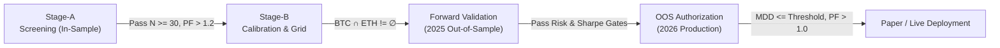

# Data Repository & Research Archive — Crypto Quant Terminal

This directory (`/data`) serves as the central persistence layer, quantitative research laboratory archive, market data lake, and runtime state repository for the **Crypto Quant Terminal**.

It houses multi-timeframe market data, production SQLite databases, real-time trading state files, execution ledgers, and the complete institutional research lifecycle documentation for Strategy Families #1 through #10.

---

## 1. Directory Structure Overview

```
data/
├── historical/                                # Multi-timeframe OHLCV & funding rate datasets
│   ├── BTCUSDT_{1m,3m,5m,15m,30m,1h,1d}.csv  # Bitcoin spot / perpetual historical bars
│   ├── BTCUSDT_30m_vol_regime.csv             # Bitcoin volatility regime annotations
│   ├── BTCUSDT_funding.csv                    # Historical 8-hour perpetual funding rates
│   ├── ETHUSDT_{5m,30m}.csv                   # Ethereum historical bars
│   ├── ETHUSDT_30m_vol_regime.csv             # Ethereum volatility regime annotations
│   ├── SOLUSDT_{5m,30m}.csv                   # Solana historical bars
│   ├── SOLUSDT_30m_vol_regime.csv             # Solana volatility regime annotations
│   ├── HYPEUSDT_{1m,3m,5m,15m,30m,1h,1d}.csv # Hyperliquid / ecosystem asset bars
│   └── HYPEUSDT_funding.csv                   # Historical funding rates
│
├── backtest_results/                          # Detailed trade-level simulation logs
│   ├── BTCUSDT_trades.csv                     # Historical simulation trade logs (BTC)
│   ├── ETHUSDT_trades.csv                     # Historical simulation trade logs (ETH)
│   ├── SOLUSDT_trades.csv                     # Historical simulation trade logs (SOL)
│   └── SOLUSDT_pullback_audit.csv             # Deep pullback verification audit records
│
├── Databases (.db)                            # Persistent SQLite storage backends
│   ├── crypto_quant.db                        # Primary research, feature, order & position DB
│   ├── telemetry.db                           # Real-time event streaming and signal telemetry
│   ├── live_trading.db                        # Isolated live execution state database
│   └── telemetry_pre_patch_*.db               # Historical telemetry database snapshots
│
├── Runtime State & Execution Ledgers          # Real-time process communication & journals
│   ├── bot_state.json                         # Current daemon status, equity, and health
│   ├── bot_commands.json                      # IPC command buffer (kill switch, pause, etc.)
│   └── trade_ledger.jsonl                     # Append-only transaction audit log (JSON Lines)
│
├── Research Protocols & Diagnostics           # Systematic strategy evaluation stages
│   ├── master_strategy_archive_index.md       # Canonical index for Era-01 directional research
│   ├── research_lessons_01.md                 # Structural failure modes & research constraints
│   ├── research_lessons_02.md                 # Empirical findings on execution friction & noise
│   ├── research_lessons_03.md                 # Microstructure and cross-asset divergence rules
│   ├── vwap_*                                 # VWAP Mean Reversion research suite
│   ├── strategy_05_*                          # Volatility Squeeze Breakout research suite
│   ├── strategy_06_*                          # Donchian Trend Channel Breakout suite
│   ├── strategy_07_*                          # Volume Displacement Continuation suite
│   └── strategy_08_*                          # Adaptive Displacement Trailing suite
│
└── Aggregated Research & Experiments          # Multi-strategy optimization studies
    ├── 50_experiments_report.json             # Large-scale multi-strategy test battery
    ├── 5_representative_backtests.json        # Benchmark strategy performance comparisons
    ├── backtest_matrix_results.csv            # Cross-parameter performance matrix
    ├── mtf_study_results.json                 # Multi-timeframe trend alignment study
    └── paper_report.html                      # Interactive HTML paper trading report
```

---

## 2. Core Databases

### `crypto_quant.db` (Primary Institutional Database)
The primary relational store (~1.05 GB) powering research, indicators, order management, and portfolio accounting.

Key tables and schemas:
- **Market Data & Features**:
  - `market_data`: Indexed OHLCV time-series by symbol, timeframe, and timestamp.
  - `features`: Pre-computed technical features, rolling statistics, and volatility metrics calculated with strict anti-lookahead bias.
  - `asset_universe`: Target trading universe definitions and historical liquidity metadata.
- **Research & Optimization**:
  - `experiments`, `experiment_results`: Systematic backtest configurations, returns, Sharpe, Sortino, MDD, and trade counts.
  - `research_candidates`: Screening candidate rosters across Stage-A and Stage-B parameter spaces.
  - `ml_models`: Serialized machine-learning weights, hyperparameters, and feature importance scores.
- **Execution & Accounting**:
  - `paper_accounts`, `live_accounts`: Equity snapshots, margin balances, and leverage allocations.
  - `live_orders`, `execution_trades`: Order lifecycle state transitions and exchange fill details.
  - `carry_positions`, `carry_funding_payments`: Cash-and-carry basis arbitrage tracking, spot-futures pairing, and accumulated funding yields.
  - `directional_positions`, `funding_harvests`: Active directional trades and funding collection records.

### `telemetry.db` (Live Telemetry & Diagnostics)
High-throughput event logging database capturing asynchronous runtime events from active workers and orchestrators:
- `signals`: Generated alpha signals, indicator snapshots at entry evaluation, admission status, and gate rejections.
- `trades`: Order fill confirmations, execution latency, and realized slippage.
- `risk_events`: Circuit breaker trips, drawdown warnings, max leverage threshold limits, and liquidation alerts.
- `positions`: Live mark-to-market position updates.

### `live_trading.db`
Isolated local runtime state database for live trade routing, reconciliation checkpoints, and broker synchronization.

---

## 3. Market Data Stores (`/historical` & `/backtest_results`)

### Historical OHLCV Series (`data/historical/`)
High-resolution market history extracted from Binance Futures and Hyperliquid APIs:
- **Covered Pairs**: `BTCUSDT`, `ETHUSDT`, `SOLUSDT`, `HYPEUSDT`.
- **Timeframes**: `1m`, `3m`, `5m`, `15m`, `30m`, `1h`, `1d`.
- **Regime Annotations (`*_vol_regime.csv`)**:
  - Merged datasets containing pre-calculated ATR expansion ratios, historical volatility deciles, and ADX regime classifications used for dynamic filtering.
- **Perpetual Funding Histories (`*_funding.csv`)**:
  - Historical 8-hour settlement rates used for funding payment reconciliation and basis carry yield modeling.

### Simulation Trade Logs (`data/backtest_results/`)
- Individual trade logs (`*_trades.csv`) recording entry timestamp, entry price, exit timestamp, exit price, duration, fees, gross PnL, net PnL, and exit reason.
- `SOLUSDT_pullback_audit.csv`: Deep-dive audit file isolating entry slippage, pullback depth, and stop placement behavior on high-beta assets.

---

## 4. Live Runtime State & Ledgers

### `bot_state.json`
Active machine-readable status file updated by the trading daemon:
```json
{
  "running": true,
  "paused": false,
  "testnet": true,
  "dry_run": true,
  "symbols": ["BTCUSDT", "HYPEUSDT"],
  "uptime": 16.65,
  "open_positions_count": 0,
  "circuit_breaker": false,
  "equity": 10000.0,
  "updated_at": 1791316513.23
}
```

### `bot_commands.json`
File-based IPC queue for controlling the background daemon without restarting processes:
- Supported commands: `PAUSE`, `RESUME`, `CLOSE_ALL`, `RELOAD_CONFIG`, `HEALTH_CHECK`.

### `trade_ledger.jsonl`
Append-only JSON Lines transaction journal recording live and paper executions:
- Contains structured records for cash-and-carry basis arbitrage (`CARRY_ARBITRAGE`) and directional trades.
- Tracks `entry_basis_spread_pct`, `spot_fill_price`, `futures_fill_price`, `estimated_fees_usdt`, and automated exit classifications (e.g., `ADVERSE_BASIS_STOP`).

---

## 5. Quantitative Strategy Research Archive (Era-01)

This repository contains the complete quantitative lifecycle records for **Era-01 (Single-Asset Directional Era)**, documenting Strategy Families #1 through #10.

### The Institutional Validation Gate Framework
Every strategy family underwent a mandatory, multi-stage gatekeeping process before any capital deployment:



1. **Stage-A (Screening)**: Broad parameter grid screening over in-sample training data (2020–2024). Filters out underperforming ideas ($N \ge 30$, $PF > 1.2$, Positive Expectancy).
2. **Stage-B (Calibration & Dual-Asset Intersection)**: Robustness testing across neighbouring parameter clusters.
   - **The Non-Negotiable Intersection Rule**: A parameter combination must be profitable simultaneously on **both** BTC and ETH ($C_{\text{dual}} = \text{BTC\_PASS} \cap \text{ETH\_PASS} \neq \emptyset$).
3. **Forward Validation**: Out-of-sample forward test over an unseen market regime (2025-01-01 to 2025-12-31).
4. **OOS Production Gate (2026)**: Final authorization test over live 2026 conditions prior to capital admission. Hard drawdown gates (e.g., $MDD \le 35\%$) cannot be overridden by net profitability.

### Strategy Family Summary Ledger

| Family | Slug / Identifier | Timeframe | Core Mechanism | Terminal Gate | Post-Mortem Finding |
| :--- | :--- | :--- | :--- | :--- | :--- |
| **#1** | `trend_filtered_rsi` | 4H | Trend-filtered RSI pullback | 2026 OOS | Win-rate collapsed from 60% (2025) to 29% (2026) on BTC; regime whipsaw. |
| **#2** | `mtf_trend_pullback` | 1H | Multi-timeframe trend alignment | Stage-B | Cross-asset transferability failure. BTC failed 0/72 parameter grid; $C_{\text{dual}} = \emptyset$. |
| **#3** | `breakout_retest` | 4H / 1D | S/R breakout with retest confirmation | Stage-A | Trade starvation ($N < 15$). Retests occurred too infrequently on crypto perpetuals. |
| **#4** | `regime_adaptive` | 1H | ADX/Choppiness state-switching | Stage-B | Excess switching frequency (3,669 trades/yr); fee drag destroyed edge ($PF = 0.82$). |
| **#5** | `volatility_squeeze_breakout` | 4H / 1H | Bollinger Squeeze expansion | Stage-B | Zero parameter intersection. BTC failed 0/48 on 4H; ETH passed 30/48. $C_{\text{dual}} = \emptyset$. |
| **#6** | `trend_channel_breakout` | 4H / 1H | Donchian channel trend breakout | Stage-B | BTC failed 0/36 on 4H & 1H due to aggressive stop runs; ETH passed. $C_{\text{dual}} = \emptyset$. |
| **#7** | `volume_displacement_continuation` | 1H | Volume-confirmed FVG displacement | 2026 OOS | Profitable on both assets (BTC +5.2%, ETH +16.7%), but breached hard $MDD \le 35\%$ gate (38.5% BTC, 36.8% ETH). |
| **#8** | `adaptive_displacement_trailing` | 1H | FVG displacement + ER filter + ATR trailing | 2025 Validation | Stage-A pass (37/37) and Stage-B intersection collapsed in 2025 validation; BTC all-negative. |
| **#9** | `volatility_compression_breakout` | 1H | Squeeze breakout with Chandelier exit | Validation / Stage-B | Breakouts into resting liquidity produced negative expectancy across all 3 protocol versions. |
| **#10** | `liquidity_sweep_mean_reversion` | 1H | Fade breakout sweeps / liquidity runs | Stage-A | 0/36 pass on both BTC & ETH. 100% of BTC candidates suffered liquidation stops. |

### Permanent Research Axioms (`research_lessons_*.md`)

1. **Sub-4H Signal Degradation**: Candlestick geometry and classical chart patterns on 1H/sub-1H crypto perpetuals exhibit low signal-to-noise ratios due to high-frequency algorithmic stop-hunting and liquidity sweeps.
2. **Microstructure Divergence**: BTC features deep order books and frequent mean-reverting sweeps; ETH exhibits higher beta and cleaner directional momentum. Identical parameters rarely exploit both regimes simultaneously without asset-specific overfitting.
3. **The Friction Barrier**: With standard round-trip fees (0.08%–0.10% taker), adverse execution slippage (0.05%–0.10%), and perpetual funding drag, any strategy generating over 200 trades/year with an average trade edge $< 0.50\%$ is structurally unviable.
4. **Governance Capital Protection**: The rigid enforcement of the Dual-Asset Intersection and Out-of-Sample Drawdown gates prevented 100% of failing directional strategies from ever putting real capital at risk.

---

## 6. Operational Guidelines & Maintenance

- **Archival Integrity**: Files prefixed with `strategy_*`, `protocol_*`, `research_lessons_*`, and `vwap_*` are canonical research records and must remain immutable.
- **Database Concurrency**: When querying `crypto_quant.db` or `telemetry.db` from external scripts or analysis notebooks, open connections in read-only mode (`?mode=ro`) or use SQLite WAL mode (`PRAGMA journal_mode=WAL;`) to avoid blocking active writer threads.
- **State Cleanliness**: Temporary smoke-test databases (`tmp_smoke_*.db`) and pre-patch telemetry backups are periodically generated during system audits and can be safely purged when the test runners complete.
- **Live Trading Safety**: Do not modify `bot_state.json` or `trade_ledger.jsonl` manually while the trading daemon is active. Send command payloads through `bot_commands.json` or system signals.
=======
# Crypto Quant Research Terminal

A production-grade quantitative research and trading system for cryptocurrency markets.

## Overview

Crypto Quant Terminal is a comprehensive quantitative research laboratory, backtesting engine, strategy discovery system, risk engine, and paper/live trading framework. It is designed for serious quantitative research with emphasis on correctness, reproducibility, and robustness.

### Key Features

- **Historical Data Engine**: Download and manage 6+ years of cryptocurrency market data
- **Feature Engineering**: 50+ technical indicators with anti-look-ahead bias protection
- **Strategy Research**: Automated strategy discovery and optimization
- **Backtesting Engine**: Event-driven backtesting with realistic execution assumptions
- **Risk Management**: Dynamic position sizing and comprehensive risk controls
- **Machine Learning**: ML-enhanced trade probability prediction
- **Walk-Forward Validation**: Rigorous out-of-sample testing
- **Monte Carlo Simulation**: Statistical risk assessment
- **Paper Trading**: Live simulation without real money
- **Live Trading**: Binance integration with safety controls (disabled by default)

## Installation

### Prerequisites

- Python 3.12+
- pip or poetry

### Setup

```bash
# Clone the repository
git clone <repository-url>
cd crypto_quant_terminal

# Create virtual environment
python -m venv .venv
source .venv/bin/activate  # Linux/Mac
# or
.venv\Scripts\activate  # Windows

# Install dependencies
pip install -e ".[dev]"

# Copy environment variables
cp .env.example .env

# Initialize the system
python -m crypto_quant init
```

### Database Setup

```bash
# Initialize database
python -m crypto_quant init --init-db
```

## Configuration

### Main Configuration

Edit `config/settings.yaml` to configure:

- **Market**: Exchange, spot/futures settings
- **Data**: Date ranges, API endpoints
- **Universe**: Asset selection (top N, custom, etc.)
- **Risk**: Capital, risk per trade, position limits
- **Trading**: Mode (paper/live), execution settings
- **Fees**: Trading fees, slippage assumptions

### Environment Variables

Create `.env` file with:

```bash
# Binance API (for live trading)
BINANCE_API_KEY=your_key
BINANCE_API_SECRET=your_secret

# Trading mode
TRADING_MODE=paper
DRY_RUN=true

# Logging
LOG_LEVEL=INFO
```

## Usage

### Terminal Interface

```bash
# Launch the terminal
python -m crypto_quant

# Or use the short command
cq
```

### CLI Commands

```bash
# Initialize system
python -m crypto_quant init

# Data management
python -m crypto_quant data download --symbol BTCUSDT --timeframe 1h

# Research
python -m crypto_quant research --strategy trend --timeframe 1h

# Backtesting
python -m crypto_quant backtest --strategy STRAT-001

# Machine Learning
python -m crypto_quant ml train --model xgboost

# Dashboard
python -m crypto_quant dashboard generate --experiment EXP-001

# Paper Trading
python -m crypto_quant paper start --strategy STRAT-001
```

## Architecture

```
crypto_quant_terminal/
├── config/                    # Configuration files
├── src/crypto_quant/          # Main source code
│   ├── cli/                   # Terminal interface
│   ├── data/                  # Data engine
│   ├── indicators/            # Technical indicators
│   ├── features/              # Feature engineering
│   ├── strategies/            # Strategy framework
│   ├── backtesting/           # Backtesting engine
│   ├── research/              # Research & optimization
│   ├── analysis/              # Trade analysis
│   ├── ml/                    # Machine learning
│   ├── validation/            # Train/test, walk-forward
│   ├── risk/                  # Risk management
│   ├── execution/             # Paper & live brokers
│   ├── exchange/              # Exchange adapters
│   ├── dashboard/             # Dashboard generation
│   ├── db/                    # Database models
│   ├── config/                # Configuration system
│   └── utils/                 # Utilities
├── tests/                     # Test suite
├── data/                      # Market data
├── models/                    # ML models
├── reports/                   # Generated reports
├── logs/                      # Application logs
└── dashboard/                 # Generated dashboards
```

## Data Management

### Downloading Data

```bash
# Download specific symbol
python -m crypto_quant data download --symbol BTCUSDT

# Download all top 20
python -m crypto_quant data download --universe top_20

# Download specific timeframes
python -m crypto_quant data download --timeframes 1h,4h,1d
```

### Data Validation

```bash
# Validate data quality
python -m crypto_quant data validate

# Check for gaps
python -m crypto_quant data validate --check-gaps
```

## Research Workflow

### 1. Download Historical Data

```bash
python -m crypto_quant data download --universe top_20 --start 2020-01-01
```

### 2. Run Research

```bash
python -m crypto_quant research --full-research
```

### 3. Analyze Results

```bash
python -m crypto_quant dashboard generate --experiment EXP-001
```

### 4. Validate Best Strategies

```bash
python -m crypto_quant validate walk-forward --strategy STRAT-001
```

### 5. Paper Trade

```bash
python -m crypto_quant paper start --strategy STRAT-001
```

## Testing

```bash
# Run all tests
pytest

# Run with coverage
pytest --cov=crypto_quant

# Run specific test file
pytest tests/test_config.py

# Run slow tests
pytest -m slow
```

## Risk Warnings

**IMPORTANT**: This system is for research and educational purposes.

- Historical performance does NOT guarantee future results
- Backtests are simulations and may not reflect real trading
- ML predictions are probabilistic, not certain
- Trading involves substantial risk of financial loss
- Never trade with money you cannot afford to lose
- Past performance is not indicative of future results

## Development

### Adding New Strategies

1. Create strategy class in `src/crypto_quant/strategies/`
2. Inherit from `BaseStrategy`
3. Implement `generate_signal()` method
4. Register in strategy registry

### Adding New Indicators

1. Create indicator function in `src/crypto_quant/indicators/`
2. Implement anti-look-ahead bias protection
3. Add tests in `tests/`

### Contributing

1. Fork the repository
2. Create feature branch
3. Write tests
4. Submit pull request

## License

MIT License - see LICENSE file for details.

## Support

For issues and questions:
- Check documentation
- Review test files for examples
- Open GitHub issue
>>>>>>> 933ec6ce4058608ef9c8b3d8de6d81cad8483c55
